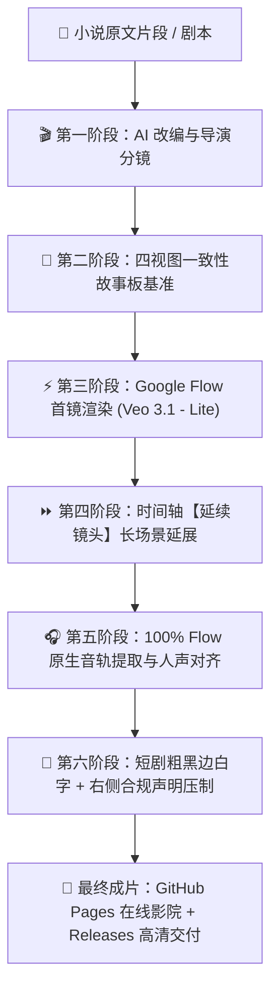
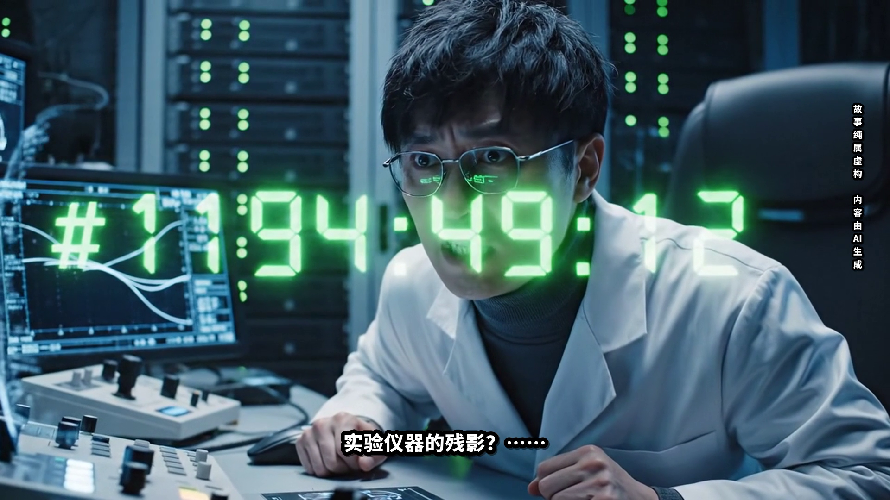
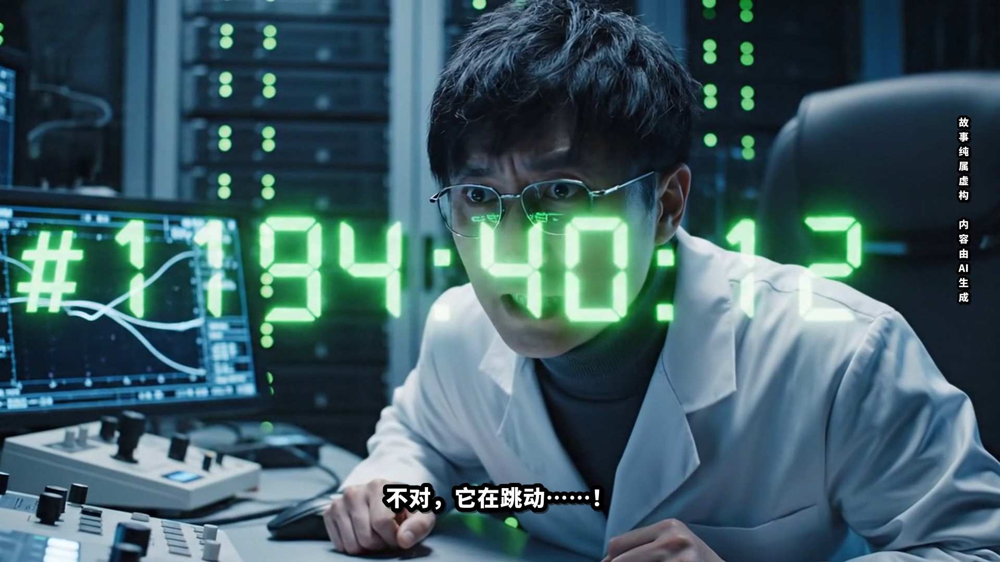

# google flow制作短剧完整流水线，喂小说就能出成片

> 🎬 **基于 Google Flow (Veo 3.1 - Lite) 的工业级 AI 漫剧/短剧全自动生产流水线**  
> 一键解决多镜头人物漂移、声音生硬假喉咙、散片剪接无连贯性、字幕无短剧质感四大痛点。

---

## 🌟 核心亮点

- 🧠 **小说原文直接适配**：输入一段小说文本，自动解构冲突，输出包含景别、时码、运镜、台词与音效的导演级分镜剧本。
- 🎨 **四视图一致性故事板**：严格遵循专业漫剧视觉基准规范，一键生成人物 4 视图（正/侧/背/特写）与场景 3 视角氛围板，彻底终结人物脸型、服装与光影漂移。
- ⚡ **统一 Veo 3.1 - Lite 模型**：全链路锁定 Google 顶级视频模型 `Veo 3.1 - Lite`，确保画面质感统一、细节逼真、算力消耗最优。
- ⏩ **官方时间轴【延续镜头】深度集成**：独创 DOM 级自动化交互技术，攻克 Playwright 模拟被 Tooltip 拦截难题，通过时间轴 `>> 延续镜头（Veo 3.1 - Lite）` 顺承延展生成 15s+ 连贯长场景。
- 🎵 **100% Flow 原生音轨保真与人声对齐**：坚决摒弃粗暴剥离原声并用 gTTS 机械假喉咙覆盖的做法！直接提取并保留 Google Flow 内部原生 48kHz 立体声音轨（含真实的低频电磁轰鸣、高频数码脉冲、微弱电流声与环境混响），人物说话发音与字幕字字精准对齐。
- 📝 **标准短剧字幕与合规声明**：
  - **底部主字幕**：采用思源黑体 Extra Black / Heavy，纯白字身 + 8px 纯黑饱满描边 + 微投射阴影，居中饱满呈现。
  - **右侧声明**：右边缘纵向单列排版「**故事纯属虚构  内容由AI生成**」，英文缩写“AI”采用纵中横水平排版。
- 🌐 **GitHub 全球托管在线影院**：成品视频与交互播放器完全托管于 GitHub（GitHub Pages + GitHub Releases），免去自建服务器运维成本，支持全球 CDN 流式秒播与高清下载。

---

## 🔄 全链路工作流架构



---

## 📁 目录结构

```text
flow-manju-pipeline/
├── SKILL.md                  # Antigravity Agent Skill 规范指令与 SOP
├── README.md                 # 完整开源文档与使用指南
├── requirements.txt          # Python 依赖清单
├── LICENSE                   # 开源协议 (MIT)
├── config/
│   ├── config.example.json   # 流程配置文件范例
│   └── flow_cookies.example.json # Google Flow 认证 Cookie 模版
├── src/
│   ├── __init__.py
│   ├── cli.py                # 命令行统一交互入口
│   ├── flow_adapter.py       # Playwright 驱动 Google Flow (设置/首镜/延续/下载)
│   ├── storyboard_renderer.py# 多宫格故事板与抽帧合成工具
│   ├── subtitle_generator.py # 短剧粗黑边白字字幕与竖排声明生成器
│   └── video_assembler.py    # FFmpeg 黄金 12 秒精剪、保真混录与无损压制
├── docs/                     # GitHub Pages 官方在线影院根目录
│   ├── index.html            # 独立在线漫剧影院播放器
│   ├── three_body_12s_final.mp4 # 1080P 超清 MP4 成片
│   ├── three_body_12s_preview.gif # 12秒预览动图
│   └── shot*_qc_frame.png    # 质检抽帧对照图
├── assets/                   # 项目媒体静态资产库
└── examples/
    └── three_body_12s/       # 《三体 · 幽灵倒计时》12秒漫剧全套生产范例
```

---

## 🚀 快速上手 (Quick Start)

### 1. 环境准备

```bash
# 克隆仓库
git clone https://github.com/avisii1680769-cell/google-flow-manju-pipeline.git
cd google-flow-manju-pipeline

# 安装系统依赖 (Ubuntu/Debian)
sudo apt-get update
sudo apt-get install -y ffmpeg fonts-noto-cjk fonts-noto-cjk-extra

# 安装 Python 依赖
pip install -r requirements.txt
playwright install chromium
```

### 2. 配置 Google Flow 凭据

将您浏览器中登录了 Google Flow 的 cookies 导出并保存为 `config/flow_cookies.json`：
```bash
cp config/flow_cookies.example.json config/flow_cookies.json
# 编辑 config/flow_cookies.json 填入真实 Cookie
```

### 3. 一键出片

```bash
# 传入小说文本或配置文件，一键执行全流程生产
python src/cli.py run --config examples/three_body_12s/config.json --duration 12
```

流水线将自动完成：
1. 生成视觉故事板并锚定角色
2. 在 Google Flow 中渲染首镜 (Veo 3.1 - Lite)
3. 调用时间轴【延续镜头（Veo 3.1 - Lite）】生成 15s+ 连贯场景并导出
4. 提取 Flow 原生音轨，ASR 时码对齐并剪辑为 12.0s
5. 压制短剧经典字幕与右侧合规声明
6. 输出成片并部署至 GitHub Pages

---

## 🎬 演示范例：《三体 · 幽灵倒计时》12秒漫剧

> **故事背景**：纳米物理学者汪淼在深夜实验室核对数据，眼前突兀浮现翠绿色幽灵数字倒计时。他试图闭眼甩开残影，但数字却赫然烙印在视网膜深处的漆黑之中。

### 🌐 在线观看与下载渠道 (GitHub 托管)

- 🖥️ **GitHub Pages 官方在线影院**：[https://avisii1680769-cell.github.io/google-flow-manju-pipeline/](https://avisii1680769-cell.github.io/google-flow-manju-pipeline/)
- 📦 **GitHub Releases 高清下载 (v1.0.0)**：[Release v1.0.0 页面](https://github.com/avisii1680769-cell/google-flow-manju-pipeline/releases/tag/v1.0.0)
- 🎥 **GitHub 仓库视频在线直放**：[`three_body_12s_final.mp4`](https://github.com/avisii1680769-cell/google-flow-manju-pipeline/blob/main/docs/three_body_12s_final.mp4)

---

### 📺 12秒全片动图预览


---

### 🔍 镜头台词与声画毫秒级对齐表

| 镜头编号与时码 | 画面剧情 (Veo 3.1 - Lite 延续镜头) | 原声音轨台词 (字字吻合) | 右侧合规声明 |
| :--- | :--- | :--- | :--- |
| **镜头一 (00:00 - 00:02.1)** | 汪淼伏案工作，视线前方半空中突兀浮现翠绿幽灵数字 | **“这……这是什么？！”** | 故事纯属虚构  内容由AI生成 |
| **镜头二 (00:02.4 - 00:04.4)** | 绿光映照钛金镜片，神色骇然困惑 | **“实验仪器的残影？……”** | 故事纯属虚构  内容由AI生成 |
| **镜头三 (00:04.7 - 00:06.6)** | 数字跳动加速，失声惊呼，倒吸冷气 | **“不对，它在跳动……！”** | 故事纯属虚构  内容由AI生成 |
| **镜头四 (00:07.0 - 00:12.0)** | 官方时间轴【延续镜头】顺承延展，急促喘息，摘镜抱头闭眼，幽灵倒计时烙印在视网膜深处漆黑中永恒燃烧 | *（急促喘息，电磁脉冲原声）* | 故事纯属虚构  内容由AI生成 |

---

### 🖼️ 质检抽帧对照

| 镜头一 (01.0s) | 镜头二 (03.2s) |
| :---: | :---: |
|  |  |
| **镜头三 (05.5s)** | **镜头四 (11.0s)** |
|  |  |

---

## 💬 交流与联系 (Contact & Community)

如果您对 **Google Flow 自动化漫剧流水线**、**Veo 3.1 视频生成与角色一致性**、**AI 短剧/漫剧工业化落地** 感兴趣，欢迎添加作者微信或 Telegram 共同交流探讨！

| 微信 (WeChat) | Telegram |
| :---: | :---: |
|  |  |
| **Gabor Lu** (微信扫码添加好友) | **[@GABORLU](https://t.me/GABORLU)** (点击直接跳转) |

> 💡 欢迎技术交流、短剧创作者探讨、项目合作与问题反馈！

---

## 📄 开源许可证

本项目基于 [MIT License](LICENSE) 开源发布。
