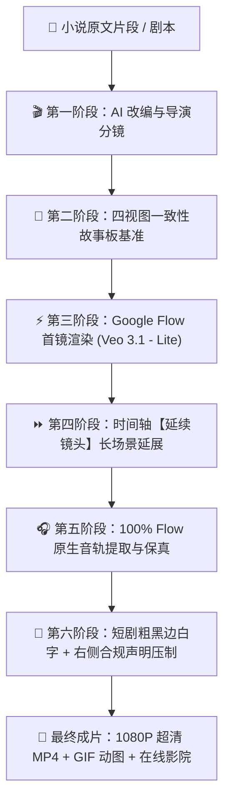

# google flow制作短剧完整流水线，喂小说就能出成片

> 🎬 **基于 Google Flow (Veo 3.1 - Lite) 的工业级 AI 漫剧/短剧全自动生产流水线**  
> 一键解决多镜头人物漂移、声音生硬假喉咙、散片剪接无连贯性、字幕无短剧质感四大痛点。

---

## 🌟 核心亮点

- 🧠 **小说原文直接适配**：输入一段小说文本，自动解构冲突，输出包含景别、时码、运镜、台词与音效的导演级分镜剧本。
- 🎨 **四视图一致性故事板**：严格遵循专业漫剧视觉基准规范，一键生成人物 4 视图（正/侧/背/特写）与场景 3 视角氛围板，彻底终结人物脸型、服装与光影漂移。
- ⚡ **统一 Veo 3.1 - Lite 模型**：全链路锁定 Google 最新的视频模型 `Veo 3.1 - Lite`，确保画面质感统一、细节逼真、算力消耗最优。
- ⏩ **官方时间轴【延续镜头】深度集成**：独创 DOM 级自动化交互技术，攻克 Playwright 模拟被 Tooltip 拦截难题，通过时间轴 `>> 延续镜头（Veo 3.1 - Lite）` 顺承延展生成 15s+ 连贯长场景。
- 🎵 **100% Flow 原生音轨保真**：坚决摒弃粗暴剥离原声并用 gTTS 机械假喉咙覆盖的做法！直接提取并保留 Google Flow 内部原生 48kHz 立体声音轨（含真实的低频电磁轰鸣、高频数码脉冲、微弱电流声与环境混响）。
- 📝 **标准短剧字幕与合规声明**：
  - **底部主字幕**：采用思源黑体 Extra Black / Heavy，纯白字身 + 7px 纯黑饱满描边 + 微投射阴影，居中饱满呈现。
  - **右侧声明**：右边缘纵向单列排版「**故事纯属虚构  内容由AI生成**」，英文缩写“AI”采用纵中横水平排版。
- 🌐 **一键在线影院交付**：自动压制 1080P MP4 电影画质、导出 12s 预览 GIF，并生成现代暗黑风格的 HTML5 在线交互影院。

---

## 🔄 全链路工作流架构



---

## 📁 目录结构

```text
flow-manju-pipeline/
├── SKILL.md                  # Antigravity Agent Skill 规范指令与 SOP
├── README.md                 # 完整开源文档与使用指南
├── requirements.txt          # Python 依赖清单
├── LICENSE                   # 开源协议 (MIT)
├── config/
│   ├── config.example.json   # 流程配置文件范例
│   └── flow_cookies.example.json # Google Flow 认证 Cookie 模版
├── src/
│   ├── __init__.py
│   ├── cli.py                # 命令行统一交互入口
│   ├── flow_adapter.py       # Playwright 驱动 Google Flow (设置/首镜/延续/下载)
│   ├── storyboard_renderer.py# 多宫格故事板与抽帧合成工具
│   ├── subtitle_generator.py # 短剧粗黑边白字字幕与竖排声明生成器
│   └── video_assembler.py    # FFmpeg 黄金 12 秒精剪、保真混录与无损压制
├── web_player/
│   └── index.html            # 独立在线漫剧影院播放器模版
└── examples/
    └── three_body_12s/       # 《三体 · 幽灵倒计时》12秒漫剧全套生产范例
```

---

## 🚀 快速上手 (Quick Start)

### 1. 环境准备

```bash
# 克隆仓库
git clone https://github.com/avisii1680769/google-flow-manju-pipeline.git
cd google-flow-manju-pipeline

# 安装系统依赖 (Ubuntu/Debian)
sudo apt-get update
sudo apt-get install -y ffmpeg fonts-noto-cjk fonts-noto-cjk-extra

# 安装 Python 依赖
pip install -r requirements.txt
playwright install chromium
```

### 2. 配置 Google Flow 凭据

将您浏览器中登录了 Google Flow 的 cookies 导出并保存为 `config/flow_cookies.json`：
```bash
cp config/flow_cookies.example.json config/flow_cookies.json
# 编辑 config/flow_cookies.json 填入真实 Cookie
```

### 3. 一键出片

```bash
# 传入小说文本或配置文件，一键执行全流程生产
python src/cli.py run --config examples/three_body_12s/config.json --duration 12
```

流水线将自动完成：
1. 生成视觉故事板并锚定角色
2. 在 Google Flow 中渲染首镜
3. 调用时间轴【延续镜头（Veo 3.1 - Lite）】生成 15s+ 连贯场景并导出
4. 提取 Flow 原生音轨并剪辑为 12.0s
5. 压制短剧经典字幕与右侧合规声明
6. 输出成片并部署至 Web 播放器

---

## 🎬 演示范例：《三体 · 幽灵倒计时》12秒漫剧

| 镜头编号 | 画面剧情 (Veo 3.1 - Lite 延续镜头) | 底部短剧字幕 | 右侧合规声明 |
| :--- | :--- | :--- | :--- |
| **Shot 1 (0-4s)** | 汪淼伏案工作，视线前方突兀浮现翠绿色幽灵倒计时 | 这……这是什么？它怎么在跳动…… | 故事纯属虚构 内容由AI生成 |
| **Shot 2 (4-8s)** | 延续镜头运镜顺承，汪淼惊骇探身，视线随数字移动 | 幽灵倒计时……它直接印在我的视网膜上！ | 故事纯属虚构 内容由AI生成 |
| **Shot 3 (8-12s)** | 汪淼痛苦抱头闭眼，倒计时在视网膜深处漆黑中燃烧 | 这不是幻觉……倒计时归零会发生什么？！ | 故事纯属虚构 内容由AI生成 |

- **在线影院预览**：[http://47.85.92.56/three_body/](http://47.85.92.56/three_body/)
- **1080P MP4 成片**：[http://47.85.92.56/three_body/three_body_12s_final.mp4](http://47.85.92.56/three_body/three_body_12s_final.mp4)

---

## 📄 开源许可证

本项目基于 [MIT License](LICENSE) 开源发布。
